# Smart Supply Chain Late Delivery Risk Prediction

## 1. Project Overview

This project predicts the risk of late delivery for supply chain orders using machine learning. It combines a trained XGBoost model with a FastAPI backend and a Streamlit dashboard. Users can submit shipment details, receive an estimated late-delivery probability, review a risk category, and inspect explanations for the prediction.

The application supports shipment monitoring and operational investigation. Predictions are estimates based on patterns learned from historical data; they do not confirm that a shipment will be late or establish the real-world cause of a delay.

## 2. Business Problem

Late deliveries can affect customer satisfaction, order planning, and supply chain operations. Identifying orders that may be at risk can help operations teams prioritize tracking reviews and investigate potential issues.

**Problem statement:** Given available order, product, customer, geographic, and scheduling information, estimate the likelihood that a shipment will be delivered late.

## 3. Objectives

- Predict late-delivery risk from shipment and order features.
- Compare machine-learning models using classification evaluation metrics.
- Apply a configurable probability threshold to classify predicted late-delivery risk.
- Explain individual predictions using SHAP.
- Present predictions and operational investigation suggestions in a Streamlit dashboard.
- Expose prediction functionality through a FastAPI REST API.

## 4. Main Features

- **Late-delivery prediction:** Returns the model's estimated probability for the positive class.
- **Risk categorization:** Uses the configured classification threshold and a separate high-risk boundary.
- **Explainability:** Uses SHAP to identify features that increase or decrease the model output for an individual prediction.
- **Readable explanations:** Groups transformed/one-hot-encoded contributions back into original input fields.
- **Operational suggestions:** Provides checks to investigate against actual shipment, warehouse, carrier, and order records.
- **Interactive dashboard:** Provides a user interface for reviewing shipment risk and available dashboard analytics.
- **REST API:** Makes predictions available through FastAPI.

## 5. Technology Stack

| Component | Technology |
|---|---|
| Programming language | Python |
| Machine-learning model | XGBoost |
| Data processing | pandas, NumPy |
| Preprocessing | Fitted scikit-learn-compatible preprocessor |
| Explainability | SHAP |
| Backend API | FastAPI |
| Request validation | Pydantic |
| Dashboard | Streamlit |
| Model artifact loading | joblib |
| Dashboard API calls | requests |
| Analysis | Jupyter Notebook |

## 6. Dataset and Features

The project dataset used during model development contains **180,519 rows**. The selected input set contains **22 original features**.

### Numerical and date-derived features

- `Days for shipment (scheduled)`
- `Order Item Discount`
- `Order Item Quantity`
- `Sales`
- `Product Price`
- `Latitude`
- `Longitude`
- `Order Year`
- `Order Month`
- `Order Day`
- `Order Day of Week`
- `Order Hour`

### Categorical features

- `Type`
- `Customer Country`
- `Customer Segment`
- `Market`
- `Customer State`
- `Order Region`
- `Order Country`
- `Category Id`
- `Product Card Id`
- `Department Id`

**Dataset source, license, and target-column definition:** Add these details from the actual data source and notebook. They are not guessed in this README.

## 7. Data Preparation and Preprocessing

The API uses the fitted preprocessor saved with the model artifacts. It builds a one-row DataFrame from submitted shipment fields, restores the feature order expected by the preprocessor, and transforms the input before prediction.

Recorded development dimensions:

- Selected original features: **22**
- Processed training features: **427**
- Processed training rows: **126,363**
- Processed validation rows: **27,078**
- Processed test rows: **27,078**

Add the exact split strategy, random seed, missing-value handling, and encoding/scaling details from the notebook for a complete record.

## Exploratory Data Analysis (EDA)

**Late Delivery Analysis**

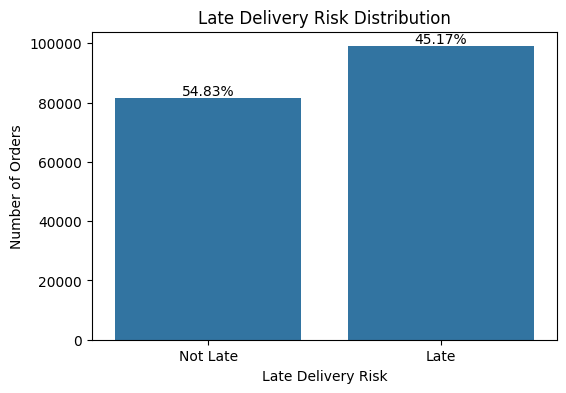

**Additional EDA Plot**

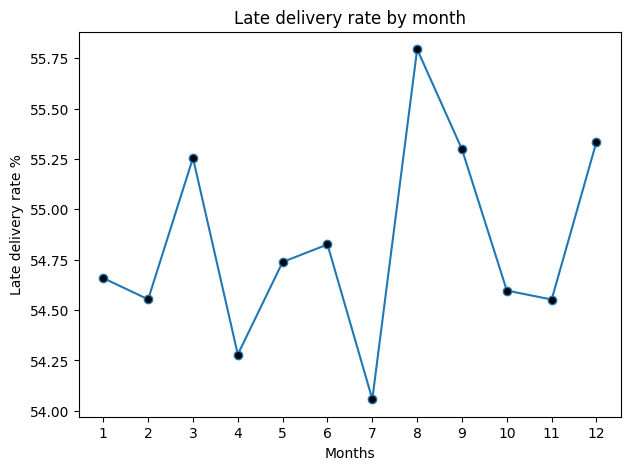

## 8. Model Comparison

The following are the evaluation results recorded during the project work.

### ROC-AUC

| Model | ROC-AUC |
|---|---:|
| XGBoost | 0.801728 |
| Decision Tree | 0.783859 |
| Gradient Boosting | Not recorded in available project notes |
| Random Forest | Not recorded in available project notes |
| Logistic Regression | Not recorded in available project notes |

### PR-AUC

| Model | PR-AUC |
|---|---:|
| XGBoost | 0.856174 |
| Gradient Boosting | 0.843199 |
| Decision Tree | 0.813611 |
| Random Forest | 0.803439 |
| Logistic Regression | 0.729403 |

XGBoost had the highest recorded ROC-AUC and PR-AUC among the listed results, so it was selected for the application.

ROC-AUC summarizes ranking performance across classification thresholds. PR-AUC summarizes the precision-recall trade-off and can be especially informative when the positive class is relatively uncommon. Neither metric alone establishes production readiness.

## Model Evaluation

**ROC-AUC Curve**

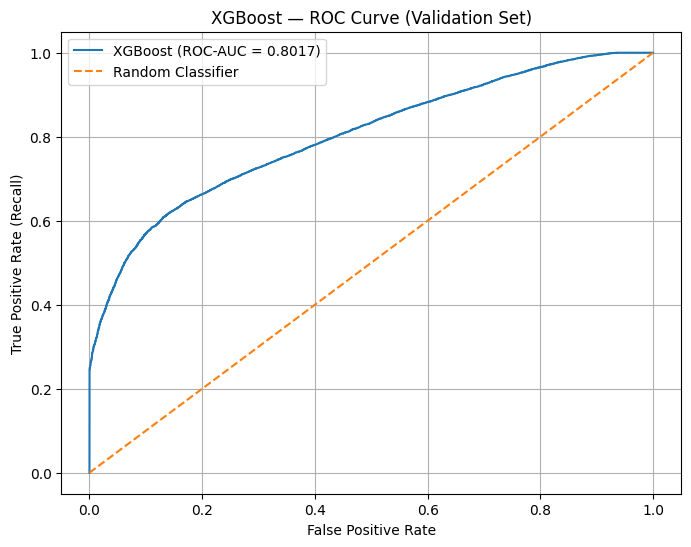

**Precision-Recall Curve**

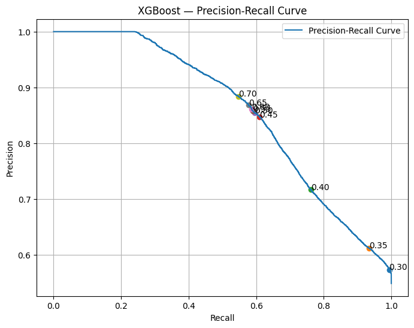

**Confusion Matrix**

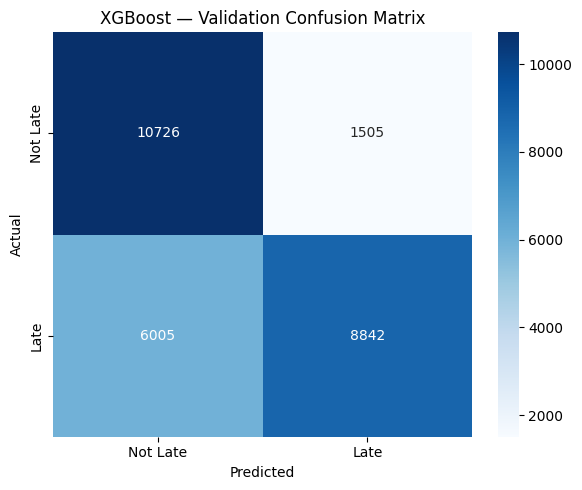

## 9. Classification Threshold and Risk Categories

The API reads the classification threshold from `artifacts["threshold"]`. The configured value established during the project is **0.35**. The API also defines a separate high-risk boundary of **0.70**.

| Predicted probability | Binary prediction | API risk category |
|---|---:|---|
| Below 0.35 | 0 — below the selected late-risk threshold | Low Risk |
| From 0.35 to below 0.70 | 1 — late-risk positive | Medium Risk |
| 0.70 or above | 1 — late-risk positive | High Risk |

The 0.35 threshold was selected during model evaluation. The 0.70 boundary is a separate category rule in the API. Thresholds should be evaluated against the operational costs of false positives and false negatives before real-world use.

## 10. Explainability with SHAP

The API uses `shap.TreeExplainer` to calculate feature contributions for an individual prediction. Because preprocessing can expand categorical columns into one-hot encoded columns, the application groups contributions back into their original input fields.

The API returns up to five features with positive grouped SHAP contributions as risk factors and up to three features with negative contributions as protective factors. It also returns plain-English explanations, submitted input values, and operational suggestions.

SHAP describes how features influence the model output for a particular prediction. These explanations are model associations, not proof that a feature caused a delay. Recommendations are investigation prompts, not confirmation of an operational issue.

## 11. Application Architecture

```text
User
 |
 v
Streamlit Dashboard
 |
 | HTTP POST /predict
 v
FastAPI Backend
 |
 +--> Validate request fields with Pydantic
 +--> Build input DataFrame in original feature order
 +--> Transform input with saved preprocessor
 +--> Predict probability with XGBoost
 +--> Apply classification threshold and risk categories
 +--> Calculate and group SHAP contributions
 +--> Generate explanations and investigation suggestions
 |
 v
JSON prediction response
 |
 v
Streamlit displays probability, risk, explanations,
recommendations, and dashboard analytics
```


## 12. Project Structure

This is a representative outline based on paths referenced by the current application. Keep your actual filenames and add other directories present in your repository.

```text

supply_chain_project/
│
├── api/
│   └── main.py
│
├── dashboard/
│   └── app.py
│
├── datasets/
│   ├── raw/
│   │   ├── DataCoSupplyChainDataset.csv
│   │   └── DescriptionDataCoSupplyChain
│   │
│   └── processed/
│       ├── DataCoSupplyChain_cleaned.csv
│       └── DataCoSupplyChain_ML_ready.csv
│
├── images/
│   ├── late_delivery_dist.png
│   ├── late_delivery_rate.png
│   ├── roc_curve.png
│   ├── precision_recall_curve.png
│   ├── confusion_matrix.png
│   ├── fastapi_docs.png
│   ├── dashboard.png
│   ├── regional_risk.png
│   ├── prediction_form.png
│   ├── prediction_output.png
│   ├── factors.png
│   └── recommendation.png
│
├── models/
│   └── xgboost_supply_chain_model.joblib
│
├── notebooks/
│   ├── 1_data_understanding.ipynb
│   ├── 2_data_cleaning.ipynb
│   ├── 3_eda.ipynb
│   ├── 4_feature_engg.ipynb
│   ├── 5_model_building_and_evaluation.ipynb
│   ├── 6_shap_explainability.ipynb
│   └── 7_risk_prioritization.ipynb
│
├── reports/
│   ├── regional_risk_analysis.csv
│   ├── shipment_risk_priority_report.csv
│   └── shipment_type_risk_analysis.csv
│
├── requirements.txt
├── .gitignore
└── README.md

```

Bracketed entries are placeholders, not claims that those exact files or directories already exist.

## 13. Installation and Running Locally

### Prerequisites

- A compatible Python installation.
- Project files, including the saved model artifact.
- Dependencies used by the API and dashboard.

### Install dependencies

If `requirements.txt` is present and up to date:

```bash
pip install -r requirements.txt
```

If the project does not yet have a dependency file, create one from the packages actually used and tested in your environment rather than relying on an unverified package list.

### Start the FastAPI backend

Run from the project root, where the `api` directory is available:

```bash
uvicorn api.main:app --reload
```

API base URL:

```text
http://127.0.0.1:8000
```

Interactive API documentation:

```text
http://127.0.0.1:8000/docs
```

## FastAPI Backend

**FastAPI Swagger Documentation**

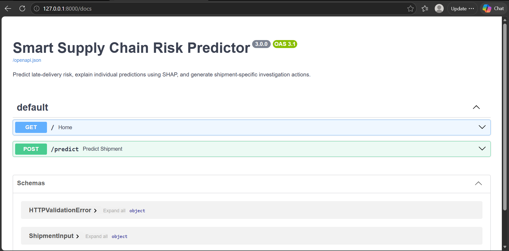  

### Start the Streamlit dashboard

Open a second terminal from the project root:

```bash
streamlit run dashboard/app.py
```

Use the local URL printed by Streamlit. The current dashboard code calls `http://127.0.0.1:8000/predict`; this is suitable for a local setup where both services can reach that endpoint. Deployment requires configuring the dashboard to use the deployed API address.

## Streamlit Dashboard

**Dashboard Overview**

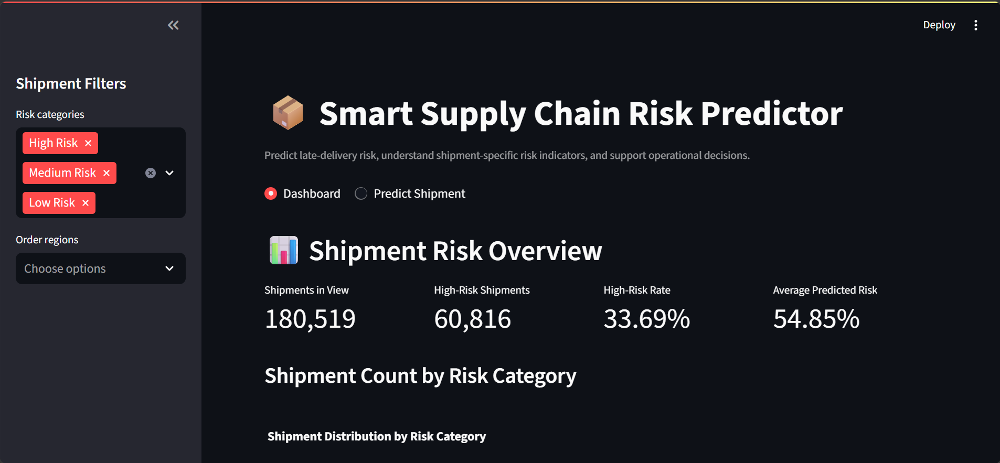

**Regional Risk Analysis**

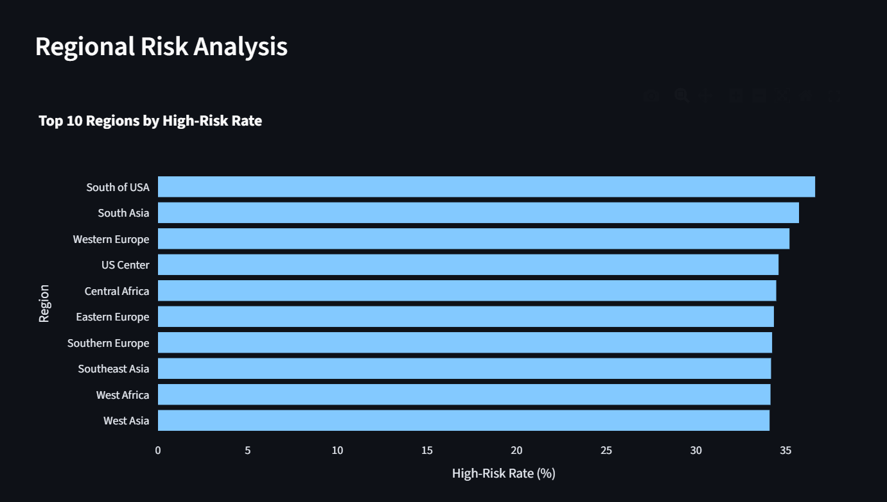

## Shipment Prediction Application

**Shipment Input Form**

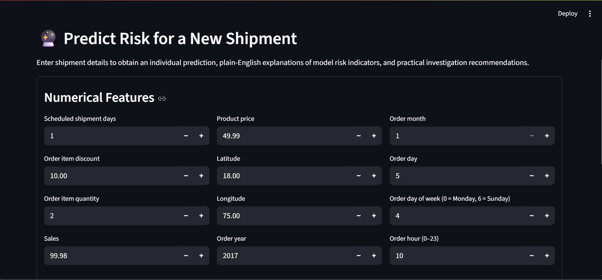

**Prediction Results**

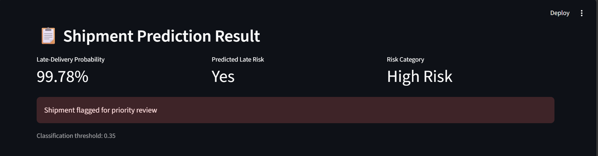

**SHAP Explanations (Risk Factors)**

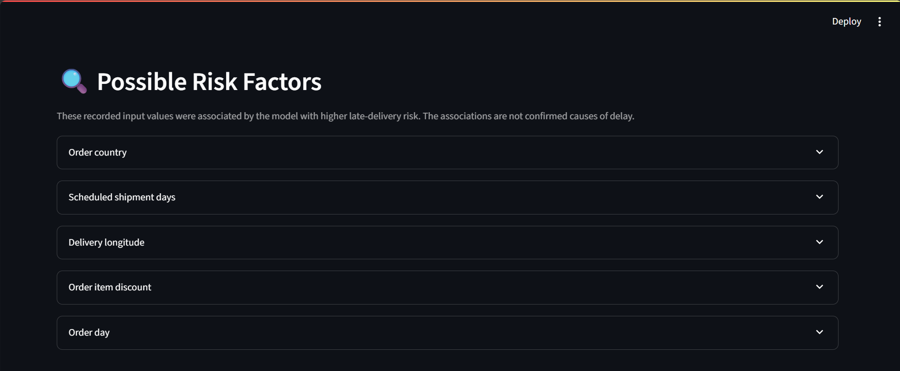

**SHAP Explanations (Recommended Actions)**

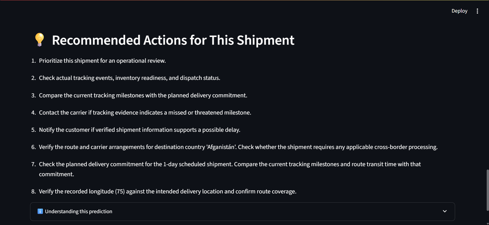

## 14. API Endpoints

### `POST /predict`

Accepts shipment fields defined by the `ShipmentInput` Pydantic model and returns a JSON response containing:

- `late_delivery_probability`
- `predicted_late_risk`
- `risk_category`
- `classification_threshold`
- `message`
- `risk_factors`
- `protective_factors`
- `recommendations`
- `explanation_note`

The exact request schema is available through the running API's `/docs` page. Use the field names and types defined in `api/main.py`.

### `GET /`

Returns a basic status response containing the API message, model class name, configured threshold, and explanation description. This is a basic status endpoint, not a full production health check.

## 15. Limitations and Responsible Use

- Predictions reflect patterns learned from historical data and may not generalize to changed operations or future periods.
- A risk prediction is not a guarantee of late delivery.
- SHAP explanations do not establish causation.
- Operational suggestions must be checked against current tracking and business records.
- The classification threshold and high-risk boundary should be reviewed against business priorities and false-positive/false-negative costs.
- Production use requires appropriate validation, monitoring, access control, logging, and data protection.
- Deployment instructions depend on the selected hosting provider and actual project configuration.

## 16. Future Improvements

Potential future work, subject to project requirements:

- Deploy the API and dashboard to a hosting platform.
- Add automated tests for API schemas, predictions, and threshold behavior.
- Monitor prediction quality and data drift.
- Add authentication and access controls if the application is exposed publicly.
- Record prediction requests and outcomes with appropriate privacy safeguards.
- Review model performance across relevant regions, customer segments, and time periods.
- Add retraining and model-version management processes.

These are potential improvements, not features claimed to be implemented already.

## 17. Author and Link

- **Author:** Mohammed Aqlath A
- **Live application:** [Add deployment URL, once deployed]


---

## Project Summary

This project demonstrates a machine-learning workflow for supply chain late-delivery risk prediction, from tabular-data preprocessing and model comparison to a FastAPI prediction service, Streamlit interface, and SHAP-based explanations. The aim is to help users identify shipments for further investigation using model estimates and recorded order information.
